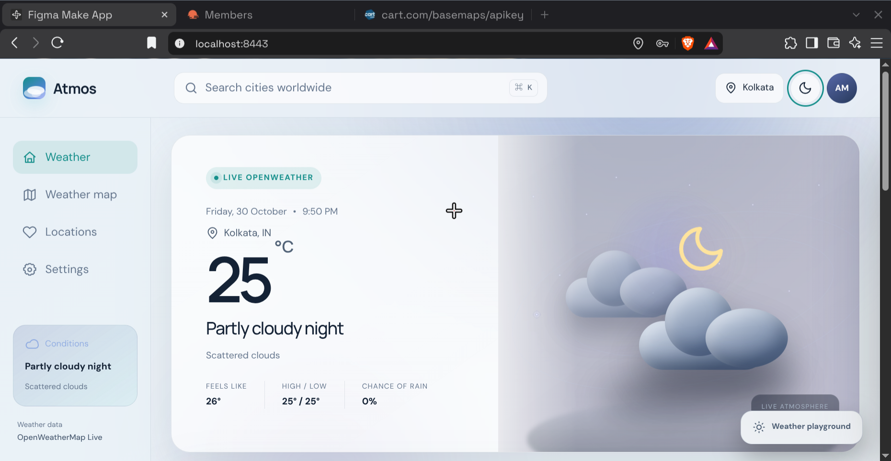
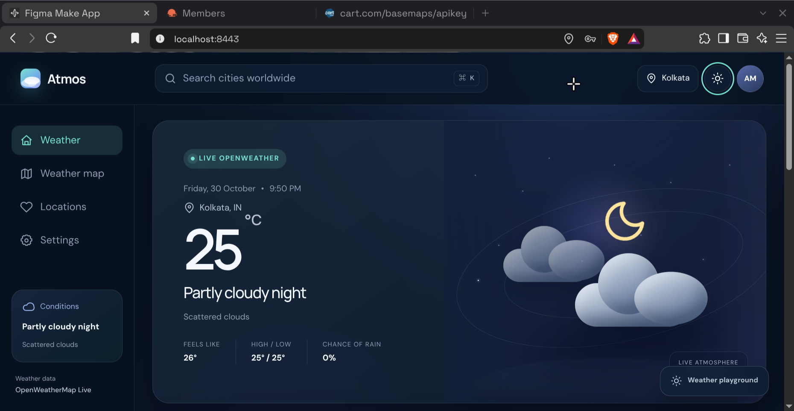
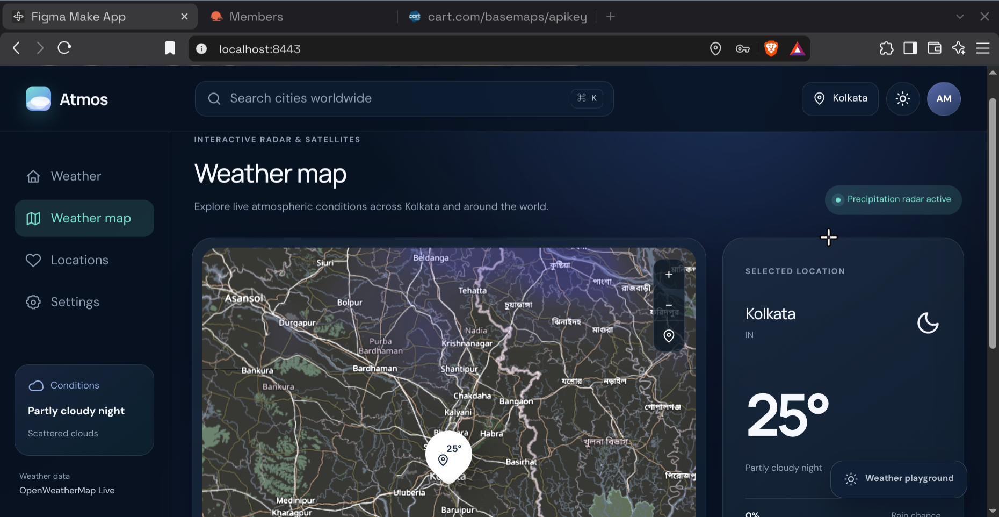
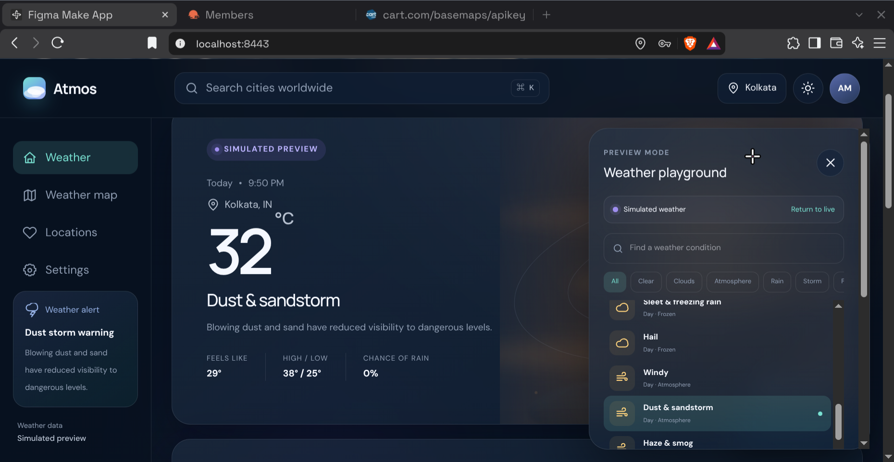

# Atmos — Premium 3D Weather Application

<div align="center">


<p align="center">
  <strong>A modern, atmospheric, production-quality weather web application powered by React 19, Leaflet, and the OpenWeatherMap API — engineered with advanced AI pair programming.</strong>
</p>

<p align="center">
  Featuring real-time meteorological observations, dynamic 3D celestial illustrations, live particle physics, 24-hour hourly carousels, 5-day extended forecasts, interactive radar maps, and a complete weather simulation playground.
</p>

</div>

---

## 🌐 Live Demo

<p align="center">
  <a href="https://atmos-weather-app-nu.vercel.app/">
    
  </a>
</p>

<p align="center">
  <strong>Experience Atmos live:</strong>
  <a href="https://atmos-weather-app-nu.vercel.app/" target="_blank">https://atmos-weather-app-nu.vercel.app/</a>
</p>

---

## 📸 Application Preview

<div align="center">

|                                                                      Light Theme                                                                      |                                                                     Dark Theme                                                                     |
| :---------------------------------------------------------------------------------------------------------------------------------------------------: | :------------------------------------------------------------------------------------------------------------------------------------------------: |
| <br><sub>_Dashboard in Daylight Mode with dynamic sun core, atmospheric hero, and hourly cards_</sub> | <br><sub>_Dashboard in Midnight Mode with live moon phase, celestial orbits, and metrics grid_</sub> |

|                                                             Interactive Weather Map                                                             |                                                            Weather Playground                                                             |
| :---------------------------------------------------------------------------------------------------------------------------------------------: | :---------------------------------------------------------------------------------------------------------------------------------------: |
| <br><sub>_Interactive Leaflet map with OpenStreetMap base cartography and radar overlays_</sub> | <br><sub>_Simulation playground drawer with fine-tuning parameter sliders_</sub> |

</div>

---

## 🌟 Overview

**Atmos** is an advanced, production-grade weather web application designed with a focus on visual craft, architectural rigor, and reliable API integration. Developed and architected using cutting-edge AI-assisted engineering, Atmos combines high-fidelity aesthetic design with robust software architecture.

Unlike basic weather widgets that display static icons and disconnected readings, Atmos integrates real-time telemetry from multiple **OpenWeatherMap** services—including Current Weather, 5-Day/3-Hour Forecast, Air Pollution, and Geocoding APIs. It feeds this telemetry into a synchronized glassmorphism user interface with dynamic 3D celestial animations, particle simulation systems, and interactive cartography.

The application is built to run reliably under all conditions: it handles live API streaming, local storage persistence, responsive cross-device layouts, in-memory caching with request deduplication, and graceful fallback modes when credentials are being set up.

---

## 🚀 Key Features

### 1. 🌤️ Real-Time Weather Dashboard

- **Current Conditions**: High-precision temperature, weather condition labels, capitalized summaries, and feels-like temperature.
- **Dynamic 3D Celestial Scene (`WeatherScene`)**:
  - Dynamically switches atmospheric illustrations between daylight sun and moonlit night based on the location's real astronomical sunrise and sunset.
  - Realistic CSS particle systems: passing rain, heavy downpours, swirling snow, sleet, hail, and high-velocity wind particles.
  - Layered cloud depth with drift animations, storm darkening, and random lightning discharges.
- **True Local Time Calculation**: Computes the exact local clock time and calendar date for any city worldwide using the API's UTC timezone offset (`timezone` shift in seconds), eliminating client/UTC time drift.
- **Astronomical Sun & Moon Cycle**: Displays real local sunrise and sunset times, calculated daylight duration (`Xh Ym daylight`), and a live sun progress tracker positioned along the daylight arc.
- **Meteorological Telemetry**:
  - **Wind Dynamics**: Speed in km/h or mph, gust calculations, 16-point cardinal direction (`WSW`, `NNE`, etc.), and live rotating compass needle (`--wind-rotation`).
  - **Humidity**: Relative humidity percentage with a visual gradient meter.
  - **UV Index**: Estimated from solar altitude, cloudiness, and base condition profiles (since standard OpenWeather 2.5 current weather endpoints exclude UV), categorized into Low, Moderate, and High exposure risk.
  - **Visibility**: Distance in kilometers or miles with horizon wave indicators.
  - **Air Quality Index (AQI)**: Powered by the OpenWeather Air Pollution API with the European/OWM 1–5 scale (Good, Fair, Moderate, Poor, Very Poor) and pollutant breakdown for PM2.5, PM10, and O₃.
  - **Severe Weather Advisories**: Built-in automated advisory engine that evaluates real-time meteorological thresholds (gale winds > 40/55 km/h, dense fog visibility < 1.5/3 km, and extreme temperatures) to surface clear advisory alerts.

### 2. ⏱️ 24-Hour Hourly Forecast

- Slices upcoming intervals from the OpenWeather 5-Day / 3-Hour Forecast API.
- Displays chronological time slots ("Now", "2 PM", "5 PM", etc.), mini condition icons, unit-converted temperatures, and precipitation probability percentages (`pop`).
- Horizontal scrolling carousel with smooth touch and drag support.

### 3. 📅 5-Day Extended Daily Forecast

- Aggregates 40 forecast data points grouped by calendar day.
- Computes true daily minimum and maximum temperatures, prevailing conditions, and icons.
- Visual temperature range bar depicting daily temperature spread relative to weekly highs and lows.

### 4. 🗺️ Interactive Weather Map (`MapView`)

- **Leaflet Mapping Engine**: High-performance, mobile-responsive interactive map.
- **OpenStreetMap Base Tiles**: Clean, reliable, and unmetered global base tiles without third-party API key watermarks or restrictions.
- **Theme-Aware Base Map**: Employs targeted CSS filters on the base layer in Dark Mode (`leaflet-dark-base-tiles`) to deliver a cinematic midnight slate aesthetic (`#0c192b`) while rendering in standard mode in Light Mode (`leaflet-light-base-tiles`), ensuring weather overlay colors are never inverted or distorted.
- **Live OpenWeatherMap Radar Overlays**:
  - 🌡️ **Temperature** (`temp_new`)
  - 🌧️ **Precipitation** (`precipitation_new`)
  - 💨 **Wind Speed** (`wind_new`)
  - ☁️ **Cloud Coverage** (`clouds_new`)
- **Interactive Coordinate Inspection**: Click anywhere on the map to drop a custom pin, reverse-geocode the location, fetch live conditions, and preview them in the sidebar card.
- **Full Forecast Navigation**: One-click transition from any inspected coordinate directly to the full dashboard forecast.
- **Map Controls**: Smooth zoom controls (`+` / `−`) and recenter-on-city button.
- **Dynamic Legend**: Adaptive gradient scale bar reflecting the active layer's unit and metric range.

### 5. ❤️ Saved Locations & Favorites

- Saves favorite cities locally in `localStorage` (`atmos_saved_locations`).
- Displays live temperature, condition label, local time, and high/low ranges for each saved place.
- Add cities through search or map inspection; remove cities via the favorite heart toggle.
- Duplicate prevention by coordinate and city name.

### 6. 🔍 Worldwide Location Search & Geolocation

- **Direct Geocoding**: Search cities, states, and countries worldwide with a 320ms debounce to prevent rate-limit exhaustion.
- **Current GPS Location**: Uses browser `navigator.geolocation` paired with OpenWeather reverse geocoding to detect and display the user's immediate local weather.
- **Keyboard Shortcut**: Press `⌘ K` (macOS) or `Ctrl + K` (Windows/Linux) to trigger search instantly; `Escape` to close.
- **Popular Destinations**: Quick-access fallbacks when search query is empty.

### 7. 🧪 Weather Playground (Simulation Sandbox)

- Dedicated simulation drawer allowing users and testers to preview any of the **23 rich atmospheric conditions** (from Clear Sky and Marine Fog to Severe Thunderstorm and Sandstorm).
- Interactive sliders to override:
  - Temperature (`-20°C` to `+48°C`)
  - Precipitation Intensity (`0%` to `100%`)
  - Wind Speed (`0 km/h` to `100 km/h`)
- Animation toggle to inspect static layouts.
- "Return to live" button restores actual API data immediately.

### 8. ⚙️ User Preferences & In-App API Key Manager

- **Units**: Toggle between Metric (Celsius `°C`, km/h, km) and Imperial (Fahrenheit `°F`, mph, miles).
- **Appearance**: Toggle between Cinematic Dark and Crisp Light themes.
- **Weather Alerts**: Enable or disable advisory banners.
- **Reduced Motion**: Respects accessibility preferences by pausing particle animations and orbital drifts.
- **In-App API Key Setting**: Configure or update an OpenWeatherMap API key directly inside the UI (persisted to `localStorage`), pairing with or overriding `.env` without needing a server restart.

---

## 🛠️ Technology Stack

| Layer                  | Technology                                       | Version              | Purpose                                                              |
| :--------------------- | :----------------------------------------------- | :------------------- | :------------------------------------------------------------------- |
| **Frontend Framework** | [React](https://react.dev/)                      | `^19.0.0`            | Declarative component UI and reactive state                          |
| **Build Tooling**      | [Vite](https://vitejs.dev/)                      | `^8.0.5`             | Fast HMR dev server and optimized production bundles                 |
| **Styling**            | [Tailwind CSS](https://tailwindcss.com/)         | `^4.0.0`             | Utility-first CSS via `@tailwindcss/vite`                            |
| **Design System**      | Custom CSS3                                      | Modern               | Glassmorphism panels, CSS particle systems, keyframes                |
| **Mapping Engine**     | [Leaflet](https://leafletjs.com/)                | `^1.9.4`             | Interactive mobile-friendly web mapping                              |
| **Base Map Tiles**     | [OpenStreetMap](https://www.openstreetmap.org/)  | Standard             | High-resolution, unmetered, open-license base cartography            |
| **Weather APIs**       | [OpenWeatherMap](https://openweathermap.org/api) | v2.5 / Geo 1.0       | Real-time weather, forecast, air quality, geocoding, and radar tiles |
| **Code Formatter**     | [oxfmt](https://github.com/oxc-project/oxc)      | `^0.2.0`             | High-speed JavaScript and JSX formatting                             |
| **Test Runner**        | Node.js Test Runner                              | Native (`node:test`) | Fast, zero-dependency unit tests for services and parsers            |

---

## 🔌 API Architecture & Endpoints

Atmos interfaces with official OpenWeatherMap endpoints through a centralized, resilient service architecture ([`src/services/weatherService.js`](src/services/weatherService.js)):

```
                             ┌──────────────────────────────┐
                             │    React Application State   │
                             └──────────────┬───────────────┘
                                            │
                       ┌────────────────────▼────────────────────┐
                       │   src/services/weatherService.js        │
                       │   - In-memory cache (10-min TTL)        │
                       │   - Inflight request deduplication      │
                       │   - Unit & timezone normalizer          │
                       │   - OWM condition code mapper           │
                       └────────────────────┬────────────────────┘
                                            │
           ┌──────────────────┬─────────────┴───────┬──────────────────┐
           ▼                  ▼                     ▼                  ▼
┌──────────────────┐ ┌──────────────────┐ ┌──────────────────┐ ┌──────────────────┐
│ Current Weather  │ │ 5-Day Forecast   │ │  Air Pollution   │ │ Geocoding API    │
│ /data/2.5/weather│ │ /data/2.5/foreca…│ │ /data/2.5/air_po…│ │ /geo/1.0/direct  │
└──────────────────┘ └──────────────────┘ └──────────────────┘ └──────────────────┘
```

### Endpoints Used

| Endpoint                                                      | Method | Role in Atmos                                                                                                   |
| :------------------------------------------------------------ | :----- | :-------------------------------------------------------------------------------------------------------------- |
| `https://api.openweathermap.org/data/2.5/weather`             | `GET`  | Fetches real-time temperature, humidity, wind speed, pressure, visibility, sunrise/sunset, and condition codes. |
| `https://api.openweathermap.org/data/2.5/forecast`            | `GET`  | 5-Day / 3-Hour forecast points transformed into the Next 24 Hours carousel and 5-Day daily summary.             |
| `https://api.openweathermap.org/data/2.5/air_pollution`       | `GET`  | Real-time air quality index and pollutant concentrations (PM2.5, PM10, O₃, NO₂, SO₂, CO).                       |
| `https://api.openweathermap.org/geo/1.0/direct`               | `GET`  | Searches worldwide cities with state and country disambiguation.                                                |
| `https://api.openweathermap.org/geo/1.0/reverse`              | `GET`  | Translates latitude and longitude from map clicks and browser GPS into city names.                              |
| `https://tile.openweathermap.org/map/{layer}/{z}/{x}/{y}.png` | `GET`  | Streams weather radar tile overlays for temperature, precipitation, wind, and clouds.                           |

### Caching & Rate-Limit Protection

- **In-Memory Cache**: All successful API responses are cached with a 10-minute TTL to stay well within free-tier rate limits.
- **Inflight Deduplication**: Concurrent requests for the same coordinates share a single network promise, preventing duplicate fetches when multiple components mount.
- **Graceful Fallback Mode**: When no API key is configured or when network errors occur, the application gracefully activates high-fidelity demo data, keeping the UI fully interactive without errors or infinite spinners.

---

## 📂 Project Architecture

```text
atmos-weather-app/
├── docs/                       # Verified application preview screenshots
│   ├── preview-dark.png        # Midnight theme dashboard preview
│   ├── preview-light.png       # Daylight theme dashboard preview
│   ├── preview-map.png         # Interactive Leaflet weather map preview
│   └── preview-playground.png  # Weather playground drawer preview
├── public/
│   └── favicon.svg             # Application brand mark
├── src/
│   ├── components/
│   │   ├── InteractiveMap.jsx  # Leaflet map with OSM base & OWM radar layers
│   │   ├── ui.jsx              # Reusable SVG icons & Button primitive
│   │   ├── WeatherAlerts.jsx   # Severe weather advisory banner
│   │   ├── WeatherPlayground.jsx # Weather simulation sandbox drawer
│   │   └── WeatherScene.jsx    # Dynamic 3D atmospheric celestial scene
│   ├── data/
│   │   └── weatherConditions.js # Definitions for 23 atmospheric conditions
│   ├── services/
│   │   └── weatherService.js   # Centralized API service, cache & normalizers
│   ├── App.jsx                 # Primary stateful application shell & views
│   ├── index.css               # Global CSS, Tailwind v4, glassmorphism & themes
│   └── main.jsx                # React 19 entrypoint mounting #root
├── test/
│   └── weatherService.test.js  # Node.js test suite for service logic
├── .env.example                # Example environment variables template
├── .gitignore                  # Git ignore rules (protects credentials and builds)
├── index.html                  # HTML5 shell
├── LICENSE                     # MIT License file
├── package.json                # Dependencies, scripts & metadata
└── vite.config.js              # Vite 8 & Tailwind CSS configuration
```

---

## ⚡ Getting Started

### Prerequisites

- [Node.js](https://nodejs.org/) (v20.x or later recommended; v18+ supported)
- [npm](https://www.npmjs.com/) (v10+ or later)
- An [OpenWeatherMap API Key](https://openweathermap.org/api) (Free Tier)

### 1. Clone the Repository

```bash
git clone https://github.com/FaiyazUllah786/atmos-weather-app.git
cd atmos-weather-app
```

### 2. Install Dependencies

```bash
npm install
```

### 3. Configure Your API Key

Copy the example environment file:

```bash
cp .env.example .env
```

Open `.env` and add your OpenWeatherMap API key:

```env
VITE_OPENWEATHER_API_KEY=your_actual_api_key_here
```

_(Alternatively, you can launch the app and paste your key into **Settings → OpenWeatherMap API Key** directly)._

### 4. Run the Development Server

```bash
npm run dev
```

Open your browser and navigate to `http://localhost:8443` (or the port shown in your terminal).

---

## 🧪 Testing & Code Quality

Atmos includes automated unit tests covering condition mapping, coordinate math, local time formatting, and data normalization.

### Run Unit Tests

```bash
npm test
```

```text
✔ mapOwmCodeToConditionId maps standard OWM codes accurately
✔ degToCompass converts wind degrees to 16-point compass directions
✔ formatLocalTime calculates local time with timezone shift without UTC drift
✔ interpretAqi returns proper European/OWM AQI labels
✔ buildUnifiedWeatherData normalizes OWM responses correctly
✔ generateDemoWeather returns complete fallback object without throwing
ℹ pass 6, fail 0
```

### Build for Production

```bash
npm run build
```

Generates an optimized, minified production build in the `dist/` directory.

### Format Code

```bash
npm run format
```

---

## 📱 Responsive Design

Atmos is engineered from the ground up for full responsiveness across all viewport sizes:

- **Desktop (1440px+)**: Dual-column dashboard, split hero layout, side-by-side metric grids, and full fixed sidebar navigation.
- **Laptop / Tablet (768px – 1100px)**: Adaptive grid reflow, compact header pill, responsive weather map with horizontal summary.
- **Mobile (< 768px)**: Fixed floating bottom navigation bar (`MobileNav`), stacked hero atmospheric view, touch-scrolling forecast carousels, and bottom-sheet simulation drawer.

---

## 📄 License

This project is open-source and available under the [MIT License](LICENSE).

---

## 👏 Acknowledgments

- Built and engineered with **AI pair programming**.
- Weather telemetry provided by [OpenWeatherMap](https://openweathermap.org/).
- Cartography by [OpenStreetMap](https://www.openstreetmap.org/) contributors.
- Mapping library by [Leaflet](https://leafletjs.com/).
- UI typography: [DM Sans](https://fonts.google.com/specimen/DM+Sans) and [Manrope](https://fonts.google.com/specimen/Manrope).
